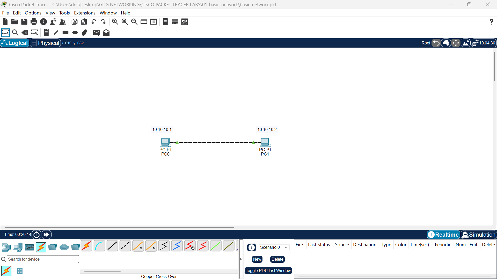
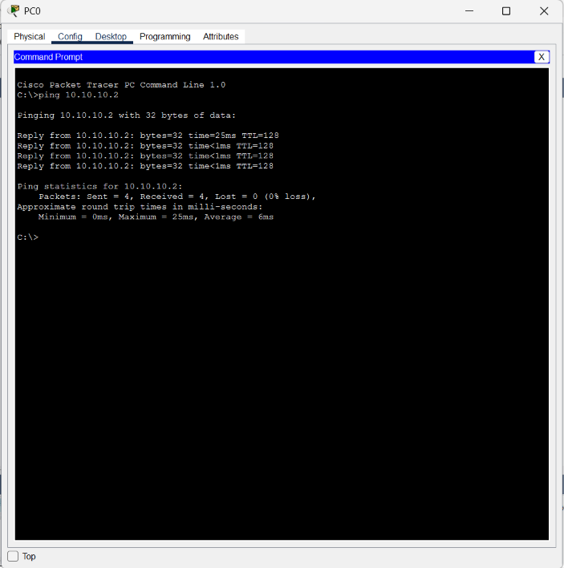

# Lab 01: Basic Network Connectivity

##  Overview

This lab demonstrates how to establish direct communication between two computers using Cisco Packet Tracer. The computers are connected using a crossover cable and configured with static IPv4 addresses.

The goal is to verify connectivity between the two devices using the `ping` command.

##  Network Setup

- **Tool:** Cisco Packet Tracer
- **Devices:** 2 PCs
- **Connection:** Copper crossover cable
- **IP Configuration:** Static IPv4 addressing

##  IP Addressing

| Device | IPv4 Address |
|---|---|
| PC0 | `10.10.10.1` |
| PC1 | `10.10.10.2` |

Both computers use addresses within the same IP subnet (`10.10.10.0/24`), assuming the default subnet mask of `255.0.0.0`.

No router is required for communication between these two directly connected computers.

##  Implementation Steps

1. Added two PCs to the Packet Tracer workspace.
2. Connected the PCs using a copper crossover cable.
3. Configured PC0 with the IP address `10.10.10.1`.
4. Configured PC1 with the IP address `10.10.10.2`.
5. Used the `ping` command to test connectivity between the computers.

##  Screenshots

### Network Topology

### Connectivity Test

##  Results

The `ping` command was used to test communication between the two PCs.

Successful ping replies confirm that the computers can communicate over the directly connected network.

##  Key Concepts Learned

- Basic network topology
- Direct PC-to-PC communication
- Static IPv4 address configuration
- IP addresses and subnet masks
- Connectivity testing using `ping`
- The role of crossover cables in traditional Ethernet connections

##  Conclusion

This lab provided practical experience building a simple network between two computers. It demonstrated how IP addressing and a direct physical connection allow devices on the same subnet to communicate without a router.

