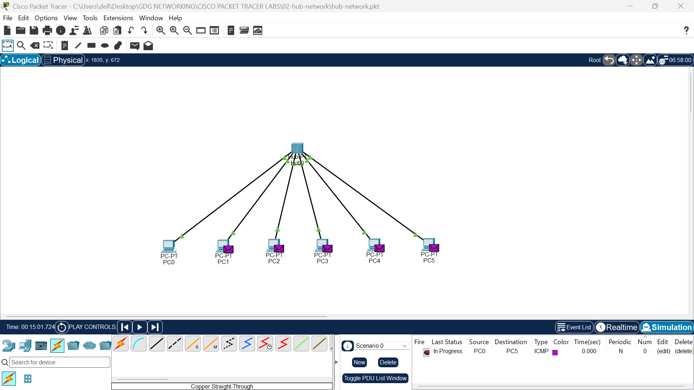

# Lab 02: Network Communication Using a Hub

##  Overview

This lab demonstrates how a network hub connects multiple computers within a local area network (LAN).

Using Cisco Packet Tracer, six computers were connected to a single hub and configured with static IPv4 addresses. A simulation was then used to observe how the hub broadcasts incoming Ethernet frames to its connected ports.

##  Network Setup

- **Tool:** Cisco Packet Tracer
- **Devices:** 6 PCs and 1 hub
- **Connection:** Ethernet cables
- **IP Configuration:** Static IPv4 addressing
- **Network Type:** Local Area Network (LAN)

##  IP Addressing

| Device | IPv4 Address |
|---|---|
| PC0 | `10.10.10.1` |
| PC1 | `10.10.10.2` |
| PC2 | `10.10.10.3` |
| PC3 | `10.10.10.4` |
| PC4 | `10.10.10.5` |
| PC5 | `10.10.10.6` |

All six computers use addresses within the same subnet, assuming a subnet mask of `255.0.0.0`.

##  Implementation Steps

1. Added six computers and one hub to the Packet Tracer workspace.
2. Connected each computer to the hub using Ethernet cables.
3. Configured each PC with a unique static IPv4 address.
4. Switched to Simulation Mode to observe network traffic.
5. Observed how the hub forwarded incoming Ethernet frames to its other ports.

##  Screenshot

### Hub Broadcasting Network Traffic

The screenshot demonstrates the hub forwarding incoming traffic across its ports rather than directing it only to the intended destination port.

##  How a Hub Works

A hub operates at **Layer 1 (the Physical Layer) of the OSI model**.

When a signal arrives on one port, the hub repeats it out through its other ports. It does not inspect destination MAC addresses to decide which port should receive the traffic.

This means:

- Incoming traffic is repeated to the other connected devices.
- All connected devices share the same collision domain.
- The intended destination processes the frame, while other devices generally discard frames not addressed to them.
- Hubs do not learn MAC addresses or make intelligent forwarding decisions.

##  Key Concepts Learned

- Connecting multiple devices using a hub
- Configuring static IPv4 addresses
- Understanding hub-based LANs
- Observing broadcast and frame forwarding behavior in simulation
- The role of hubs at the Physical Layer of the OSI model
- The difference between hubs and switches

##  Conclusion

This lab demonstrated how a hub connects multiple computers and repeats incoming traffic to its other ports. It also highlighted a key limitation of hubs: they send traffic broadly instead of forwarding frames selectively based on MAC addresses.

Modern Ethernet networks generally use switches instead of hubs because switches can forward frames to the appropriate ports, reducing unnecessary traffic.

