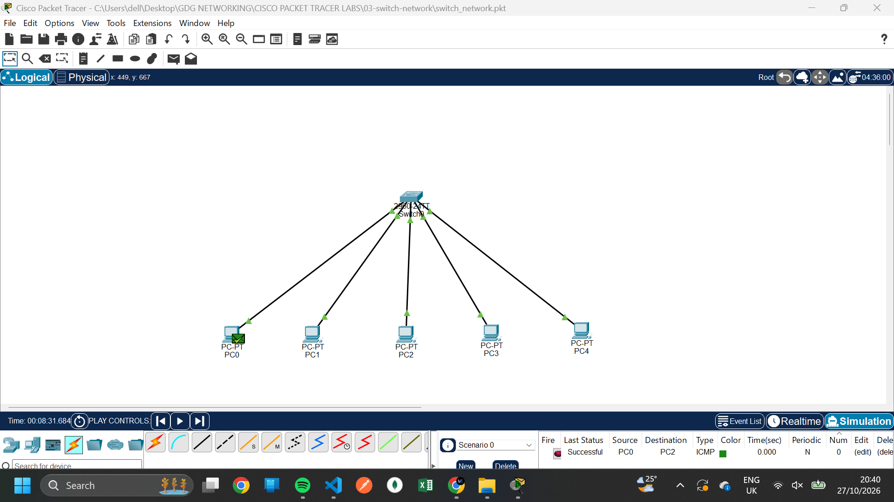

# Lab 03: Network Communication Using a Switch

##  Overview

This lab demonstrates how an Ethernet switch connects multiple computers within a Local Area Network (LAN).

Using Cisco Packet Tracer, five computers were connected to a single switch and configured with static IPv4 addresses. Network traffic was observed to understand how a switch forwards Ethernet frames between connected devices.

##  Network Setup

- **Tool:** Cisco Packet Tracer
- **Devices:** 5 PCs and 1 switch
- **Connection:** Ethernet cables
- **IP Configuration:** Static IPv4 addressing
- **Network Type:** Local Area Network (LAN)

##  IP Addressing

| Device | IPv4 Address |
|---|---|
| PC0 | `10.10.10.1` |
| PC1 | `10.10.10.2` |
| PC2 | `10.10.10.3` |
| PC3 | `10.10.10.4` |
| PC4 | `10.10.10.5` |

All five computers are configured within the same subnet, assuming a subnet mask of `255.0.0.0`.

##  Implementation Steps

1. Added five computers and one switch to the Packet Tracer workspace.
2. Connected each computer to the switch using Ethernet cables.
3. Configured each computer with a unique static IPv4 address.
4. Generated network traffic between the computers.
5. Observed the switch's behavior using Packet Tracer.

##  Screenshot

### Switch Operation

The screenshot illustrates the switch handling network traffic between connected devices.

##  How a Switch Works

An Ethernet switch operates primarily at **Layer 2 (the Data Link Layer) of the OSI model**.

Unlike a hub, which repeats incoming signals to its other ports, a switch examines Ethernet frames and uses their destination MAC addresses to determine where to forward them.

Key characteristics:

- **MAC address learning:** The switch learns source MAC addresses and associates them with the ports where frames arrive.
- **Selective forwarding:** If the destination MAC address is known, the switch forwards the frame through the appropriate port.
- **Unknown destinations:** If the destination MAC address is unknown, the switch generally floods the frame to the other ports in the same VLAN.
- **Reduced collisions:** Each switch port is its own collision domain, unlike a traditional shared hub.

##  Key Concepts Learned

- Connecting multiple computers using an Ethernet switch
- Configuring static IPv4 addresses
- Understanding Layer 2 switching
- Learning how switches use MAC addresses
- Observing network traffic in Packet Tracer
- Comparing switches with hubs

##  Conclusion

This lab provided practical experience building a switched LAN with five computers. It demonstrated how switches use MAC addresses to forward Ethernet frames more selectively than hubs, improving the efficiency of local network communication.

