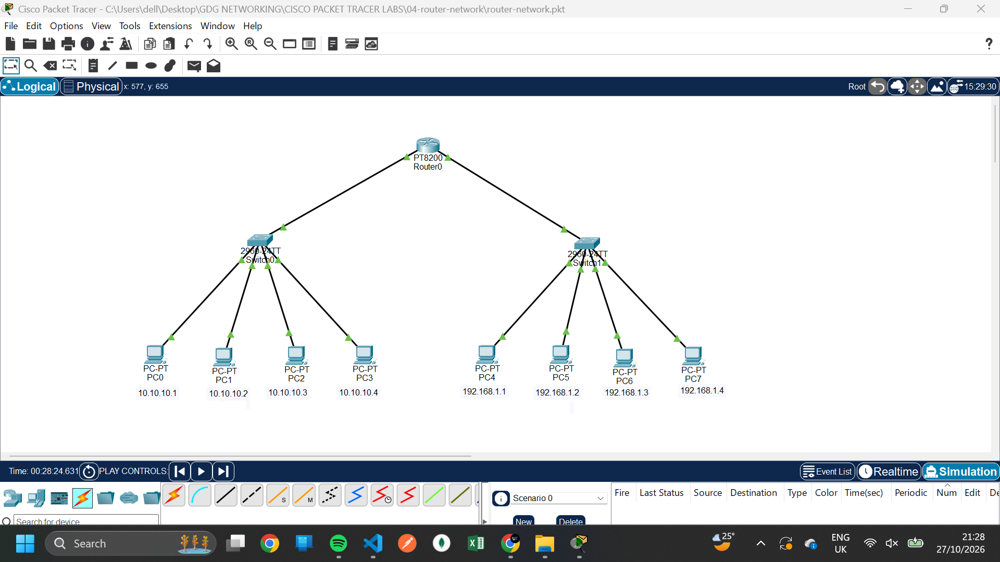
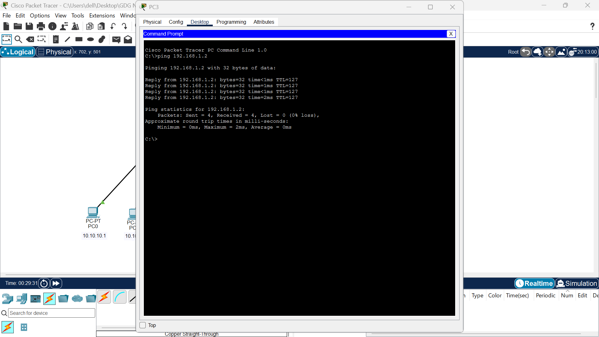

# Lab 04: Connecting Two LANs Using a Router

##  Overview

This lab demonstrates how a router connects two separate Local Area Networks (LANs) and enables communication between devices on different IP subnets.

Using Cisco Packet Tracer, two LANs were created using switches and end devices. Each LAN was assigned a different IPv4 address range, with the router serving as the default gateway for devices in each network.

##  Network Setup

- **Tool:** Cisco Packet Tracer
- **Devices:** 1 router, 2 switches, and 9 PCs
- **Network Type:** Two separate LANs
- **IP Configuration:** Static IPv4 addressing
- **Routing Device:** Router

##  IP Addressing

### LAN 1

| Device | IPv4 Address |
|---|---|
| PC0 | `10.10.10.1` |
| PC1 | `10.10.10.2` |
| PC2 | `10.10.10.3` |
| PC3 | `10.10.10.4` |
| Default Gateway | `10.10.10.5` |

**Subnet:** `10.10.10.0/24`

### LAN 2

| Device | IPv4 Address |
|---|---|
| PC4 | `192.168.1.1` |
| PC5 | `192.168.1.2` |
| PC6 | `192.168.1.3` |
| PC7 | `192.168.1.4` |
| Default Gateway | `192.168.1.5` |

**Subnet:** `192.168.1.0/24`

Both networks use a subnet mask of `255.255.255.0`, assuming `/24` configuration.

The default gateways are the router interface addresses that devices use to reach destinations outside their own subnet.

##  Implementation Steps

1. Created two separate LANs in Cisco Packet Tracer.
2. Connected the PCs in each LAN to their respective switches.
3. Assigned static IPv4 addresses to all PCs.
4. Configured the default gateway for each LAN.
5. Connected both switches to the router.
6. Configured the router interfaces with the corresponding gateway addresses.
7. Tested communication between devices on different LANs using `ping`.

##  How a Router Works

A router operates primarily at **Layer 3 (the Network Layer) of the OSI model**.

Unlike a switch, which forwards Ethernet frames within a LAN using MAC addresses, a router forwards IP packets between different IP networks using its routing table.

In this lab:

- Each switch connects devices within its own LAN.
- Each router interface provides a gateway for its respective subnet.
- When a PC sends traffic to another subnet, it forwards the traffic to its default gateway.
- The router examines the destination IP address and forwards the packet toward the destination network.

##  Screenshots

Add your topology and connectivity screenshots to the `screenshots/` folder.

### Network Topology

### Connectivity Test

##  Key Concepts Learned

- Connecting multiple LANs using a router
- IPv4 addressing and subnetting basics
- Configuring default gateways
- Understanding the role of switches and routers
- Routing packets between different IP subnets
- Testing end-to-end connectivity using `ping`

##  Conclusion

This lab demonstrated how a router connects two separate LANs and enables communication between devices on different subnets. It reinforced the importance of IP addressing, default gateways, and router interface configuration in network communication.

---

**Lab Status:** Completed