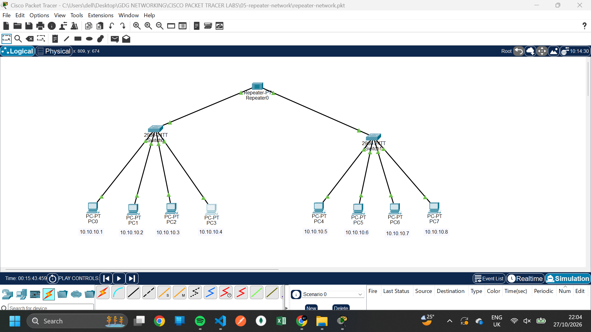
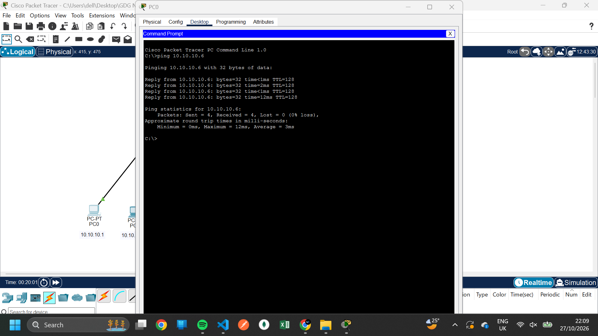

# Lab 05: Extending Network Signals Using a Repeater

##  Overview

This lab demonstrates the use of a repeater to regenerate and retransmit signals between two network segments.

Using Cisco Packet Tracer, eight computers were divided into two groups, with four computers connected to each switch. The two switches were connected through a repeater to explore how signals can be extended across a network.

##  Network Setup

- **Tool:** Cisco Packet Tracer
- **Devices:** 8 PCs, 2 switches, and 1 repeater
- **Network Type:** Local Area Network (LAN)
- **IP Configuration:** Static IPv4 addressing
- **Subnet Mask:** `255.255.255.0` (assuming a `/24` configuration)

##  IP Addressing

### Network Segment 1

| Device | IPv4 Address |
|---|---|
| PC0 | `10.10.10.1` |
| PC1 | `10.10.10.2` |
| PC2 | `10.10.10.3` |
| PC3 | `10.10.10.4` |

### Network Segment 2

| Device | IPv4 Address |
|---|---|
| PC4 | `10.10.10.5` |
| PC5 | `10.10.10.6` |
| PC6 | `10.10.10.7` |
| PC7 | `10.10.10.8` |

All eight computers belong to the same IP subnet, `10.10.10.0/24`, assuming the stated subnet mask. No router is required for communication between these devices because they are configured within the same subnet.

##  Implementation Steps

1. Added eight PCs, two switches, and one repeater to the Packet Tracer workspace.
2. Connected four PCs to the first switch.
3. Connected the remaining four PCs to the second switch.
4. Connected the switches through the repeater.
5. Configured each PC with a unique static IPv4 address.
6. Used the `ping` command to test connectivity between computers on opposite sides of the repeater.

##  Screenshots

### Network Topology

### Connectivity Test

##  How a Repeater Works

A repeater operates at **Layer 1 (the Physical Layer) of the OSI model**.

Its primary function is to receive a weakened signal, regenerate it, and retransmit it so that the signal can travel farther.

Key characteristics:

- Regenerates and retransmits signals.
- Helps extend the physical reach of a network.
- Does not examine IP addresses or MAC addresses to make forwarding decisions.
- Does not route packets between different IP networks.

In this topology, the switches connect the computers within each group, while the repeater provides signal regeneration along the connection between the two sides.

##  Key Concepts Learned

- The role of repeaters in networking
- Signal regeneration and network extension
- Connecting switches and end devices
- Static IPv4 address configuration
- Testing connectivity using `ping`
- Understanding the Physical Layer of the OSI model

##  Conclusion

This lab provided practical experience using a repeater in Cisco Packet Tracer. It demonstrated the repeater's role in regenerating signals and extending the physical reach of a network.

It also reinforced the distinction between Layer 1 devices, which handle physical signals, and Layer 2 switches, which forward Ethernet frames.

